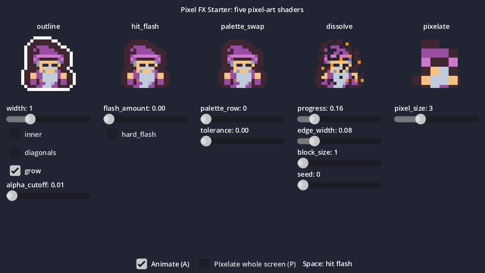

# Pixel FX Starter

[](https://github.com/revenantworks/godot-pixel-fx/actions/workflows/ci.yml)

Five free 2D shaders for Godot 4.7 that keep pixel art crisp: `outline`, `hit_flash`,
`palette_swap`, `dissolve` and `pixelate`. One demo scene shows them all. Apache-2.0 licence.



## What it does

Every shader reads whole texture pixels with `texelFetch`. No shader ever blends half pixels,
even when the node's texture filter is linear or its scale is not a whole number. The tests
check this on a GPU, pixel by pixel.

| Shader | What it does |
|---|---|
| `outline` | A 1 to 8 pixel outline, outside or inside the sprite, square or plus-shaped |
| `hit_flash` | Flashes the sprite one colour, from one `flash_amount` value |
| `palette_swap` | Swaps colours through a small palette texture, one palette per row |
| `dissolve` | Removes whole pixels (or whole blocks) in a noise pattern, with an edge colour |
| `pixelate` | Pixelates the screen behind it, or a node's own texture |

## Install

1. Copy the `addons/pixel_fx/` folder into your project's `addons/` folder. Keep its
   `LICENSE` and `NOTICE` files with it.
2. Set your project's default texture filter to Nearest:
   `rendering/textures/canvas_textures/default_texture_filter = Nearest`.
   (The shaders do not need it, but the rest of your pixel art does.)

## Use

On a `Sprite2D`: Inspector, **Material**, **New ShaderMaterial**, then load a shader from
`res://addons/pixel_fx/shaders/`. Set the shader parameters in the Inspector or from code:

```gdscript
var mat := $Player.material as ShaderMaterial
mat.set_shader_parameter("flash_amount", 1.0)
```

### outline

| Parameter | Default | Meaning |
|---|---|---|
| `outline_color` | black | Outline colour. The node's modulate alpha still fades it. |
| `width` | 1 | Width in whole texture pixels, 0 to 8. 0 turns it off. |
| `inner` | false | true draws on the sprite's own edge pixels instead of outside them. |
| `diagonals` | false | true fills corners too (square outline). false gives a rounder plus shape. |
| `grow` | false | true grows the quad so an outer outline is not cut off by a sprite with no transparent border. |
| `alpha_cutoff` | 0.01 | A pixel is solid when its alpha is above this. |

### hit_flash

| Parameter | Default | Meaning |
|---|---|---|
| `flash_color` | white | Flash colour. Its alpha scales the flash strength. |
| `flash_amount` | 0 | 0 is the normal sprite, 1 is the full flash colour. |
| `hard_flash` | false | true snaps to on or off at 0.5, so no in-between colours appear. |

### palette_swap

| Parameter | Default | Meaning |
|---|---|---|
| `palette` | none | The palette texture (see below). |
| `palette_row` | 1 | Which row to swap to. 0 keeps the original colours. |
| `tolerance` | 0.004 | How close a colour must be to match, per channel (0.004 is about 1 step in 255). |

Palette texture: row 0 lists the sprite's colours, one pixel each. Every row below lists the
replacement colours in the same order. Colours not in row 0 are kept. `tools/make_palette.gd`
builds a palette from a sprite with hue-turned rows to start from:

```
godot --headless --path . -s res://tools/make_palette.gd -- res://my_sprite.png res://my_palette.png 3
```

### dissolve

| Parameter | Default | Meaning |
|---|---|---|
| `progress` | 0 | 0 is the whole sprite, 1 is fully gone. Animate this. |
| `edge_color` | orange | Colour of the pixels about to go. |
| `edge_width` | 0.08 | Share of the noise range painted with the edge colour. |
| `block_size` | 1 | Size of one dissolve block in texture pixels. |
| `seed` | 0 | Change it for a different pattern. The same seed gives the same pattern on every GPU. |

### pixelate

| Parameter | Default | Meaning |
|---|---|---|
| `pixel_size` | 4 | Size of one big pixel, in screen pixels (or texture pixels in texture mode). |
| `use_screen` | true | true reads the screen behind the node. false reads the node's own texture. |

Screen mode: add a `CanvasLayer`, put a `ColorRect` in it that covers the screen, and give the
`ColorRect` this shader. Everything drawn on lower layers is pixelated. Inside a `SubViewport`
it pixelates that viewport only.

## Limits

- `outline` with `grow` works on a whole texture. On a region, an atlas frame or an
  `AnimatedSprite2D` sheet, give the frames a transparent border of `width` pixels instead.
- `palette_swap` matches up to 64 colours per palette.
- `pixelate` in screen mode works in screen pixels, so with a stretched window one big pixel
  covers `pixel_size` window pixels, not texture pixels.
- Tested on Godot 4.7.2 with the Compatibility renderer (OpenGL). The shaders use no
  renderer-specific features, but Forward+ and Mobile (Vulkan) have not been tested yet.
- `canvas_item` shaders only. Not for 3D materials.

## Demo

Open the project in Godot 4.7 and press F5. `demo/demo.tscn` shows each shader on one
sprite with a slider or toggle per setting. The sprite is from Tiny Dungeon by Kenney
(CC0, https://kenney.nl); see `demo/art/CREDITS.md`. Keys: **Space** hit flash, **P** pixelate the
whole screen, **A** animate on or off.

## Tests

30 tests in `tests/`. 9 run headless (shaders compile with the documented parameters, the
demo scene wires every node and control). 21 draw on a GPU and check exact pixels; under
`--headless` they are counted as skipped, never as passed. The runner fails when the file
or test count differs from the expected totals, so a test file that fails to parse cannot
hide.

Linux or macOS (uses `xvfb-run` when there is no display):

```
GODOT=/path/to/godot tools/check.sh
```

Windows (PowerShell 7):

```
pwsh -File tools/check.ps1 -Godot <full path to the Godot console exe>
```

Store screenshots come from the real demo scene only (the ones in `screenshots/` were taken
this way):

```
godot --path . -s res://tools/capture_screenshots.gd
```

## Licence

Apache License 2.0. See `LICENSE` and `NOTICE`. You may use the shaders in free and commercial
games. If you redistribute them, in source or inside a build, keep the `NOTICE` text with
them: that is the credit the licence asks for.

## Support and contributing

- Questions and ideas: [Discussions](https://github.com/revenantworks/godot-pixel-fx/discussions).
- Bugs and feature requests: [New issue](https://github.com/revenantworks/godot-pixel-fx/issues/new/choose).
- Security problems: the private form in [`SECURITY.md`](SECURITY.md). Do not open a public issue.
- Pull requests: read [`CONTRIBUTING.md`](CONTRIBUTING.md) first. Every push to `main` runs the
  full test suite, a PII scan and CodeQL in GitHub Actions.

See also [`SUPPORT.md`](SUPPORT.md), [`CODE_OF_CONDUCT.md`](CODE_OF_CONDUCT.md) and
[`ACCESSIBILITY.md`](ACCESSIBILITY.md).

## AI use

The shader code, demo scene, tools and tests were written with Claude (Anthropic) and are
reviewed and tested by Revenantworks. No image, sound or font in this asset is AI-made: the
demo sprite is Kenney CC0 art.

Made by Revenantworks.
